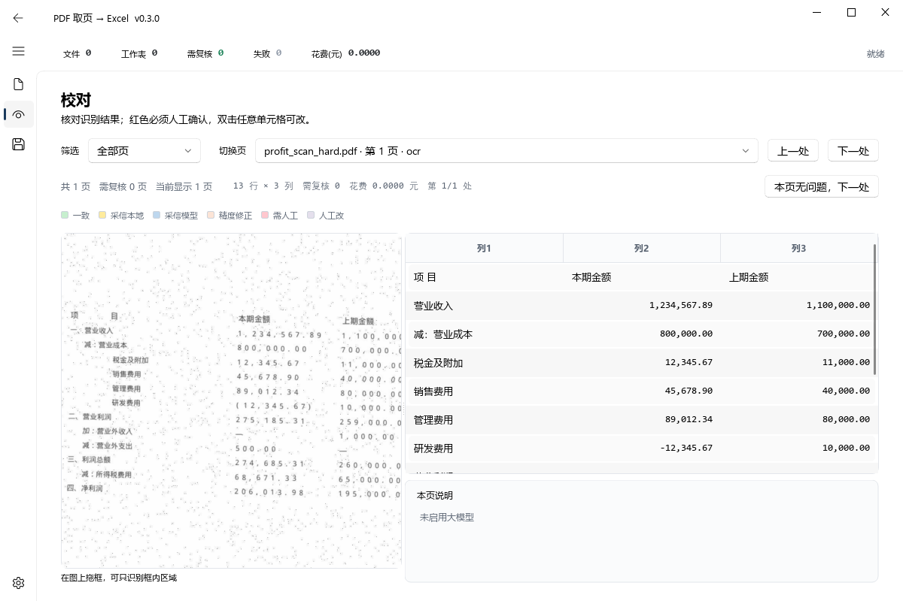

# PDF 取页 → Excel

从一批 PDF 里把指定页取出来、识别成表格、合成一份 Excel。专为**扫描件、双语表单、带框线的财务报表**设计。

- **按页码取**，或**按表名自动找**（支持扫描件，繁简自动兼容）
- **按表格线还原版式**：合并单元格、列宽、行高、字号、边框，一个子表一张工作表
- **三级识别降级**：文本层抽表 → 本地 OCR → 视觉大模型（可选），能用免费的就不到收费的
- **校对可规模化**：默认只列出需要人看的页，进页自动停在第一个红格
- **默认全程本机**：不开大模型时 PDF 内容不离开电脑

## 快速开始

### 方式一：直接用 exe（不需要装 Python）

1. 到 [Releases](../../releases) 下载 `pdf-pages-to-xlsx-v0.3.0-win64.zip`（约 210 MB）
2. 解压到任意目录
3. 双击 `PDF取页转Excel.exe`

> 首次启动会加载 OCR 模型，约 2 秒。
> 未做代码签名，Windows 可能弹「已保护你的电脑」——点「更多信息」→「仍要运行」。

### 方式二：从源码运行

```powershell
python -m pip install -r requirements.txt
python main.py
```

要求 Python 3.10+（实测 3.13.12）。Windows 10/11。

> ⚠️ `opencv` 必须装 **contrib** 版（`opencv-contrib-python-headless`）。
> img2table 需要 `cv2.ximgproc`，普通 `opencv-python` 没有这个子模块，
> 会直接报 `module 'cv2' has no attribute 'ximgproc'`。

## 文档

| 文档 | 内容 |
|---|---|
| [`使用说明书.html`](使用说明书.html) | **给使用者**：五步流程、大模型设置、10 条常见问题、合规提示（单文件，可单独分发） |
| [`使用说明书.md`](使用说明书.md) | 上者的 Markdown 源文件 |
| 本文 | **给开发者**：设计取舍、实测数据、踩过的坑 |

## 目录结构

```
core/          识别与导出的核心逻辑（无 GUI 依赖，可单独调用）
  layout.py      按表格线还原版式（单元格/合并/列宽/字号/脚注/页眉）
  tables.py      文本层抽结构化表格
  numbers.py     会计数值规范化（OCR 错误还原 + 拒绝猜测）
  ocr.py         RapidOCR 封装 + 文字框→表格重建
  llm.py         视觉大模型客户端（通义千问 / 任何 OpenAI 兼容接口）
  reconcile.py   三方对账（本地 OCR / 规则 / 模型）
  pipeline.py    单页编排
  search.py      按标题搜页（繁简折叠）
  writer.py      写 xlsx（黑框加粗 + 版式还原 + 列宽自适应）
  secure_store.py  API Key 用 Windows DPAPI 加密存储
gui/           PyQt5 + PyQt-Fluent-Widgets 界面
tools/         打包、截图、版式自查工具
tests/         测试（268 passed, 2 skipped）
```

## 测试

```powershell
python -m pytest tests -q
```

部分用例依赖 `demo_pdfs/` 里的自造样例，仓库默认不收录（避免误带真实单据）。
没有样例时相关用例自动 skip，核心逻辑测试不受影响。

## 版本

当前 0.3.0。技术细节、实测数据、踩坑记录见下方各章。

---

## 当前状态

GUI 已完成，`core/` + `gui/` 共 **268 个测试通过**（含真实 API 联网用例）。

启动：双击 `run_gui.cmd`，或 `python main.py`



| 模块 | 作用 | 状态 |
| --- | --- | --- |
| `core/layout.py` | **按表格线还原版式（单元格/合并/列宽/字号/脚注/页眉）** | 完成 |
| `core/tables.py` | **从文本层抽结构化表格（含几何/框线信息）** | 完成 |
| `core/numbers.py` | 会计数值规范化（OCR 错误还原 + 拒绝猜测 + 币种前缀） | 完成 |
| `core/ocr.py` | RapidOCR 封装 + 文字框→表格重建（行列聚类、缩进保留） | 完成 |
| `core/llm.py` | 视觉大模型客户端（通义千问） | 完成，已实测 |
| `core/reconcile.py` | 三方对账（本地 OCR / 规则 / 模型） | 完成 |
| `core/pipeline.py` | 单页编排：结构化抽表 → 本地 OCR → 版式还原 → 大模型 | 完成 |
| `core/search.py` | 按标题在 PDF 全文里搜页（繁简折叠） | 完成 |
| `core/writer.py` | **写 xlsx：黑框加粗 + 版式还原 + 列宽自适应** | 完成 |
| `core/secure_store.py` | API Key DPAPI 加密存储 | 完成，已实测 |
| `gui/theme.py` | 设计令牌（配色/字号/间距/等宽数字） | 完成 |
| `gui/components.py` | 卡片、页容器、状态块 | 完成 |
| `gui/import_page.py` | 导入 + 按页码 / 按标题搜索 | 完成 |
| `gui/review_page.py` | 页面图（可框选）+ 可编辑表格 + 状态着色 | 完成 |
| `gui/export_page.py` | 导出选项与执行 | 完成 |
| `gui/settings_page.py` | 大模型配置 + 隐私确认 | 完成 |
| `gui/worker.py` | 后台线程（处理 / 搜索 / 导出 / 测连接） | 完成 |

## 一、识别与导出的还原（核心改进）

### 识别：三级取表，不再丢结构

**旧实现的严重缺陷**：只要页面有文本层，就按行切文本。
实测 `demo01.pdf` 有完整框线、pdfplumber 能抽出完美 3×4 表，
但旧实现输出 **13 行 × 1 列** —— 结构信息白丢。

现在（`core/tables.py`）：

| 顺序 | 方法 | 适用 | 实测结果 |
| --- | --- | --- | --- |
| 1 | pdfplumber `find_tables()` | 有框线 / 空白清晰的表 | `demo01.pdf` → **3×4** |
| 2 | `extract_by_words()` 自己的坐标聚类 | 无框线的报表 | 损益表 → **13×3** |
| 3 | 本地 OCR + 大模型 | 扫描件 | 13×3 |

`extract_by_words` 的关键设计（都是踩坑后改的）：

- **按「列间空白间隙」切列**，不按列起点 —— 表头「项 目」被拆成两个词会多出假列
- 间隙阈值用**相对值**（最大间隙的 45%），固定阈值会漏切（实测 22pt 的真间隙被 22.5 阈值漏掉）
- 数字/文本混排时按词框中心落格，不按左边缘
- 自动裁掉表头上方的标题行 / 编制单位行
- 自动删掉整列为空的列

### 扫描件：两套列检测，按效果选（`core/ocr.py`）

密集表单（行号 + 长标签 + 两个金额列）会让「左/右边缘聚类」把几条 bounds
撑成互相覆盖的大区间，于是每行的所有框都落到同一列 —— 实测一整页 52 行只剩
**1 个非空格**，导出成 A 列一整段文本。

现在两套都跑，取「实际用上的列数更多」的那套：

| 方法 | 强项 | 弱项 |
| --- | --- | --- |
| `find_columns`（左/右边缘聚类） | 稀疏报表，13×3 这类 | 密集表单会塌成一列 |
| `columns_from_numbers`（数字框右边缘 + 标签列） | 金额右对齐的表单，行号｜项目｜本期｜前期 | 数字少于 4 个时不可用 |

实测（客户提供的 18 页扫描税表第 4 页）：**1 列 → 4 列**，52 行里有 45 行至少两格有内容。

并且新增「结构没抽出来」判定（`is_weak_grid`）：七成以上行只有一格有内容，
就把该页标成 `weak_structure`，结果条和 toast 直接说「这几页只有整行文本，
导出后要人工整理」，不再静默当成成功。

### 按表格线还原版式（`core/layout.py`，扫描件优先走这条）

印刷表格线是现成的坐标信息，比任何文本聚类都准。流程：

```
页面 PNG → img2table(OpenCV) 切出单元格 bbox
        → x/y 边缘聚类成严整网格（行数/列数/列宽/行高）
        → bbox 跨多列/多行 = 合并单元格
        → 现有 RapidOCR 盒子按「中心落在哪个格」归位并拼接
        → 字号由文字框高度换算，并按列宽再压一次（放不下就标 wrap）
        → 一个子表一个工作表：合并/居中/列宽/行高/字号/边框
```

为什么一个子表一个 sheet：**Excel 的列宽是工作表级的**，同一张表里放不下
三种列宽（实测这一页三个子表的列数分别是 5/7/5）。这一条与最初方案里
「同一 sheet 分段」不同，是按 Excel 的限制改的。

依赖：`img2table`（MIT）+ `opencv-contrib-python-headless`（提供 `cv2.ximgproc`，
原先是 `opencv-python-headless`，没有这个子模块，img2table 会直接报
`module 'cv2' has no attribute 'ximgproc'`）。

配套工具：`tools/render_layout_preview.py <pdf> <页码> [out.png]`
把还原结果按同一坐标系画出来，与原件左右并排，用来判断合并/居中/列宽对不对。

已知未解决（按影响排序）：表头跨列判定有时差一格（a)/b) 窄注释列把表头文字挤到两格）、
表下脚注 a)~e) 仍被并进表格行、部分浅色竖线漏检导致子表内错行。

已解决的版式问题（都有实测依据）：`$` 与金额被切成两列（→ 符号列并回左邻列）、
长文本溢出到隔壁格（→ 按列宽压字号，压到最小就标 wrap 并把行高抬到放得下）、
表格外的页眉（纳税人/年度/附件号）整块丢失（→ 单独抽成页眉行写在第一张表上方）。

### 导出：黑框加粗 + 版式 1:1

| 项 | 原来 | 现在 |
| --- | --- | --- |
| 框线颜色 | `BFBFBF` 浅灰，几乎看不见 | **`FF000000` 纯黑** |
| 框线粗细 | 全 thin | **外框 medium、内框 thin** |
| 表头 | 无分隔 | 灰底 + 下方 medium 加粗线 |
| 行高 | 默认 | **按 PDF pt 还原**（26pt → 26.0） |
| 列宽 | autofit | **按 PDF pt 换算**（110pt → 20.95） |
| 网格线 | 显示 | **隐藏**（只留表格自己的框） |
| 数字 | 文本 | 真数值 + 千分位 + 负数红色 |

> ⚠️ 踩坑：`Side(color="000000")` 会被 openpyxl 当 ARGB 解析成
> `00000000`（全透明），打印出来是**看不见的线**。必须写全 8 位 `FF000000`。

## 二、两种取页方式

**按页码**：统一第 N 页 / 在清单里逐个填 / 每个文件的全部页。

**按标题搜索**（新增）：输入表名，程序扫描每个 PDF 的全文，命中哪页就提哪页。
一个文件命中多页时，各占一个工作表。

匹配策略（`core/search.py`）：

| 方式 | 说明 | 分数 |
| --- | --- | --- |
| `exact` | 去掉空白标点后完全相等 | 1.0 |
| `contains` | 标题出现在某一行里；行越短分数越高 | 0.5~0.9 |
| `fuzzy` | 标题字符按顺序出现（容忍 OCR 插字） | 0.3~0.5 |

实测（6 页 PDF，3 页含「管理费用明细表」）：

```
搜索「管理费用明细表」→ 命中 [2, 4, 6] 页
  第 2 页  [exact]     命中行='管理费用明细表'
  第 4 页  [contains]  命中行='管理费用明细表（续）'
  第 6 页  [contains]  命中行='管理费用明细表附注'
```

> 短标题（归一化后 < 2 字）只允许精确匹配 —— 否则「表」会命中所有行。
> 扫描件默认搜不到，需勾选「扫描件也搜」（走本地 OCR，免费但慢）。

## 三、模型实测结论（2026-10-23，真实 key）

测试素材：一份损益表，做了倾斜 -2.5°、高斯模糊 0.9、对比度降到 0.65、2 万噪点、JPEG quality 45，并封装成**无文本层** PDF。

| 模型 | 数字命中 | 耗时 | 结论 |
| --- | --- | --- | --- |
| **qwen3-vl-plus** | **24/24** | 11.3s | 采用。手写件也 18/18（硬样本 65.6s） |
| qwen3.6-flash | 24/24 | 8.9s | 最快，但手写硬样本 17/18（把 `—` 读成 `--`） |
| qwen3.8-flash | 24/24 | 16~35s | 慢（思考模式） |
| qwen3.7-plus | 24/24 | 17~41s | 慢 |
| qwen3.5-plus | 24/24 | 58s | 很慢 |
| qwen-vl-ocr / qwen3.5-ocr | 输出非 `rows` 结构 | 3~10s | 需单独适配，未采用 |

**关键实测发现（都写进代码注释了）：**

1. **`detail` 参数被静默忽略** —— low / high / 不传，`image_tokens` 都是 2147。清晰度只能靠我们自己渲染 DPI 控制。
2. **图片只能放 user 消息** —— 放 system 返回 `400 InternalError.Algo.InvalidParameter ... wrong position (e.g., in system/ass...`。
3. **`response_format={"type":"json_object"}` 可用**，显著减少 markdown 围栏；但仍需剥 ` ```json ` 围栏。
4. **端点**：`https://dashscope.aliyuncs.com/compatible-mode/v1`（OpenAI 兼容）。

## 四、级联设计（LLM 不当主力 OCR）

```
一页 PDF
├─ 有文本层且能抽出结构 → 本地文本层（免费、精确、不调 API）
├─ 有文本层但抽表失败   → 本地 OCR 打底 + 大模型标结构
└─ 无文本层（扫描/手写）→ 本地 OCR + 大模型，逐格对账
```

依据：本地 RapidOCR 对中文几乎满分（实测扫描版损益表 42 个框，中文全对，置信度 0.99+），
错的全在数字（`2 7 5, 1 8 5. 3 1` 这类插空格）。而大模型会编数字——审计场景里幻觉数字比漏识别更危险。
所以**数字优先本地 + 规则还原，大模型负责结构与兜底**。

## 五、数值规范化的「不猜」原则

能确定性还原的：

| 原文（实测 OCR 输出） | 结果 | 规则 |
| --- | --- | --- |
| `2 7 5, 1 8 5. 3 1` | 275185.31 | `digit_space` |
| `1.234.567.89`（逗号被读成点） | 1234567.89 | `dot_thousand` |
| `(1 2, 345. 67)` | -12345.67 | `paren_negative` + `digit_space` |
| `1.2万` | 12000 | `wan_scale` |
| `１２３４` | 1234 | `fullwidth` |
| `—` / `-` / `／` | 0 | `dash_zero` |

**必须拒绝的**（猜错会得到差 100 倍的数）：

| 原文 | 结果 | 原因 |
| --- | --- | --- |
| `1,100,000,00` | **None** | 末组 2 位，很可能是小数点被认成逗号 |
| `000000` | **None** | OCR 噪声 |
| `274.685 31` | **None** | 少一个小数点，形状不吻合 |
| `1234.56789` | **None** | 小数位异常 |

解析不出来的单元格：**留空 + 标红 + 进人工复核**，绝不当 0、绝不猜。

## 六、三方对账（审计可追溯的前提）

每格记录：`原文 → 规则 → 本地值 → 模型值 → 最终值 → 状态 → 置信度 → 说明`

| 状态 | 颜色 | 含义 |
| --- | --- | --- |
| `agree` | 绿 C6EFCE | 三方一致 |
| `local` | 黄 FFEB9C | 本地与规则一致、模型不同，采信本地 |
| `model` | 蓝 BDD7EE | 本地置信度 <0.90 或无法解析，采信模型 |
| `conflict` | 红 FFC7CE | 都不行，必须人工 |
| `manual` | 紫 E4DFEC | 人工改过，以此为准 |

**实测踩到的三个 bug（已修 + 已加回归测试）：**

1. **漏传 OCR 置信度**：手写件把 `700,000.00` 读成 `720000`（置信度 0.729），
   因为没把 score 传给对账函数，错误采信了本地值。修复后正确标为 `model`。
2. **按索引对齐行**：模型和本地 OCR 行数常常不等（模型会多出/漏掉表头），
   按索引直接比会把 A 行数字跟 B 行比，产生大量假差异。
   改成按第 0 列文本相似度对齐（精确 > 后缀 > 包含）。
3. **丢小数位被当成"一致"**：本地把 `275,185.31` 读成 `275,185.3`、
   把 `274,685.31` 读成 `274,685`，置信度仍 0.97+，被误判为「采信本地」。
   新增 `precision` 状态：整数部分相同、只是一方少读小数位时，采信更完整的那个，
   单独标橙色并计入需复核。

修复前后对比（同一份扫描件）：

| | 修复前 | 修复后 |
| --- | --- | --- |
| conflict | 15 | **0** |
| agree | 17 | **18** |
| 需复核 | 20 | **6**（含 2 个 precision） |
| 导出值 `营业利润` | 275185.30 ❌ | **275185.31** ✅ |
| 导出值 `利润总额` | 274685.00 ❌ | **274685.31** ✅ |

## 七、成本（官方定价核对）

`qwen3-vl-plus` 华北2（北京），输入 ≤32k 档：输入 **1 元/百万**，输出 **10 元/百万**。

实测单页约 2200 输入 + 400 输出 token → **约 0.006 元/页**。
10 页 ≈ 0.06 元，100 页 ≈ 0.6 元。有文本层的页 **0 元**（不调 API）。

## 八、API Key 安全

- Windows DPAPI 加密（`win32crypt.CryptProtectData`），密文 base64 存
  `%APPDATA%\pdf2xlsx\config.json`
- 实测：配置文件里**搜不到明文**，同机同用户可正常解密
- 换机器/换 Windows 账户解不开，会提示重新填写
- 非 Windows 环境退化为「不落盘」，只在内存保留

## 九、测试

```powershell
cd pdf2xlsx
python -m pytest tests -q                          # 257 passed, 2 skipped
$env:QWEN_API_KEY="sk-..."                         # 可选：跑真实 API 用例
python -m pytest tests/test_llm.py -k Live -q      # 2 passed
```

测试文件：

| 文件 | 覆盖 |
| --- | --- |
| `test_numbers.py` | 规范化规则 + 拒绝猜测 + dot_thousand |
| `test_ocr.py` | 行列聚类、缩进层级（用实测坐标 fixture） |
| `test_llm.py` | 请求体结构、重试策略、错误码映射、成本计算 |
| `test_reconcile.py` | 6 种状态判定、颜色、容差、精度修正 |
| `test_pipeline.py` | 行对齐、置信度传递、文本层零成本、越界处理、`on_stage` 回调 |
| `test_writer.py` | 数字写真值、空格不写 0、着色、校验页可追溯 |
| `test_search.py` | 标题匹配（精确/包含/模糊）、短标题保护、扫描件 OCR 兜底、按文件/按页取消 |
| `test_gui.py` | 构造期不弹模态框、隐私门禁、切页、窗口渲染 |
| `test_feedback.py` | 进度到 100%、失败常驻状态列、取消标「已取消」、重试不覆盖成功页、搜索可取消 |
| `test_layout.py` | 按表格线还原：合并标题居中、文字归格、货币符号贴合、字号不溢出、脚注不吞数据行、列宽不出现 `###` |
| `test_tables.py` | 框线检测、行列边界、无框线坐标聚类 |

## 十、GUI 用法

```
run_gui.cmd          # 或：python main.py
```

界面四页，左侧图标导航，顶部常驻状态条（文件数 / 工作表数 / 需复核 / 失败 / 花费）。

1. **导入**
   - 添加文件或文件夹（也可直接拖进窗口）
   - 选「按页码」或「按标题搜索」
   - 按标题时输入表名 → 点搜索，命中页自动加入清单
   - 点「开始处理」后**停在导入页**看「状态」列逐页推进：全部成功会自动跳去
     校对页；有失败则留在导入页，结果条直接列出失败页和原因
2. **校对**
   - 左侧页面图，右侧表格；彩色只表示数据可信度
   - 双击单元格改值，改完标紫
   - **在图上拖框** → 只识别框内区域并重跑该页
3. **导出**：选保存位置与选项 → 开始导出
4. **设置**：填 API Key → 测试连接 → 启用开关（首次启用弹隐私确认）

### 视觉设计说明

定位是**审计现场的生产力工具**，不是消费级应用。取舍：

| 决策 | 理由 |
| --- | --- |
| 冷灰底 `#F7F8FA` + 纯白卡片 | 财务数据要冷静克制，暖色会显得在修饰什么 |
| 深墨蓝 `#1A3A5C` 只给主操作 | Fluent 默认青色太轻浮 |
| 彩色只用于状态（绿/黄/蓝/橙/红/紫） | 颜色只承载信息，不做装饰 |
| 数字用等宽 + 右对齐 + 千分位 | 核对时不会看错位 |
| 不用渐变、阴影堆叠、装饰插图 | 减少视觉噪声 |

### 处理中的反馈设计（进度 / 失败 / 取消）

一次 10 页的批处理要跑半分钟到两分钟，中间必须让人知道「还在动、跑到哪、哪页挂了」。
状态分四层，各管一件事，不靠会消失的提示：

| 层 | 位置 | 内容 | 为什么需要 |
| --- | --- | --- | --- |
| 进度 | 顶部状态条 | 进度条 + 百分比 = **已完成页数 / 总页数** | 用真实完成数，不在每页开始前预支 |
| 阶段 | 进度条左侧 | `第 3/6 页 · 本地 OCR · 已用 00:01 · 预计还需 00:03` | 一页要几秒到十几秒，文字每秒在变才不像卡死 |
| 单项 | 清单「状态」列（第 6 列） | 待处理 / 处理中 / 完成 / 需复核 / 失败 / 已取消 | **常驻**，刷新后仍在；悬停看每页明细 |
| 结论 | 清单上方结果条 | `处理结束：成功 5 页，失败 1 页` + 失败原因逐条 + 「重试失败项」 | 失败不能随 toast 消失 |

配套规则：

- **运行期间不弹 toast**：Fluent 的提示条在右上角，正好压住进度条和阶段文字。
  运行中的反馈全部走状态条 + 状态列，toast 只用于批次结束的结论
- **失败不混进完成**：顶栏 `工作表` 只数拿到表的页，另有单独 `失败` 计数；
  结果条写「成功 5 页，失败 1 页」，不写「6 个工作表」
- **取消**：跑起来后导入页主按钮原地变成「取消处理」（这个位置不会被提示条挡住）。
  点一下停止派发后续页，已完成的保留，未开始的标「已取消」，不会显示成「完成」
- **搜索也能取消**：按标题搜索时主按钮变成「取消搜索」，按文件 + 按页两级中断
  （扫描件走 OCR，一页要一两秒）。取消后**不会**自动开始处理，已扫到的命中不加入清单
- **搜索进度按页算**：先读各文件页数求和，再逐页推进 `搜索 14/16 页·xx.pdf 第 1/1 页`。
  按「第几个文件」报的话，单文件 15 页会一上来就是 100%，看着像卡死（实测踩过）
- **0 命中要解释**：不再只弹 6 秒 toast，改成常驻结果条
  `搜索「损益表」：扫了 8 个文件 16 页，0 命中`，附「共识别到 N 个字符（来自文本层/走了 OCR）」
  和三条排查方向。字符数为 0 说明根本没读出字（纯图片/加密页），搜索用不上，直接按页码取
- **标题被拆行也能命中**：逐行匹配失败后，再把整页文字拼起来找一次 ——
  扫描件 OCR 常把「损益表」拆成三行，只逐行比永远不命中（实测）
- **一个文件多页**：清单行显示聚合态（`完成 3 页` / `失败 1/2`），悬停列出逐页明细
- **失败自动滚进可见区**，长清单也不会看着像"没处理"
- **重试只重跑失败页**，已成功的页不重算、不覆盖
- **批次级异常也收尾**：worker 外层 `try/finally` 保证 `finished_all` 一定发出，
  否则界面上会永远停在「处理中」

### 踩过的 UI 坑（都修了）

| 现象 | 根因 | 解法 |
| --- | --- | --- |
| 搜索一上来就 100% 然后不动 | 进度按「第几个文件」报，单个 15 页扫描件永远是 1/1=100% | 改成按页报：先数总页数，再逐页推进 |
| 搜完「什么都没有」 | 0 命中只弹 6 秒 toast，界面不留任何痕迹 | 常驻结果条写清搜了什么、扫了多少页、识别到多少字符 |
| 明显有的标题搜不到 | `match_in_text` 逐行比，OCR 把标题拆成三行就永远不中 | 逐行失败后再把整页拼起来找一次 |
| 进度条永远差一格 | 每页**开始前**发 `i-1`，最后一页跑完停在 (n-1)/n | 改成每页**结束后**发 `i`，收尾再发 `total` |
| 进度条一闪就没 | 结束时立刻 `hide()`，100% 看不到 | 停在 100%，3 秒后收回 |
| 失败页无处可查 | 只发了 6 秒 toast，清单里没有任何记录 | 清单加「状态」列 + 结果条，常驻 |
| 失败页被算成工作表 | 汇总用 `len(results)`，失败页也有 `PageResult` | 成功/失败分开计数，各自显示 |
| 一页跑十秒像卡死 | 期间界面只有静止的进度条 | `process_page(on_stage=...)` 回调 + 每 500ms 刷新耗时 |
| 想停停不下来 | 线程有 `cancel()`，界面上没有按钮 | 主按钮原地变成「取消处理」（放在右上角会被 toast 挡住） |
| 点设置崩溃/卡死 | `_load_into_ui` 里 `setChecked` 触发 `checkedChanged` → 弹模态框，而它在构造期 | 加载配置时 `blockSignals`；状态不一致就静默关闭开关 |
| 主按钮一直是青色 | `PrimaryPushButton` 是自绘控件，QSS 覆盖不了 | 用 Fluent 的 `setThemeColor(T.PRIMARY)` |
| 卡片是灰的 | `QWidget#card{background}` 被 Fluent 主题覆盖 | 改 `paintEvent` 直接画 |
| 设置页底部按钮被切掉 | 重写 `Page.layout()` 让页面尺寸塌成 100×30 | 不重写 `layout()`，改用 `vlayout` 属性 |
| 滚动区不滚动 | `widgetResizable` 把内容拉伸到视口高度 | 把 body 最小高度同步到内容 `sizeHint` |
| 状态条挤到左边 | 插进了 `hBoxLayout` 而不是纵向容器 | 取出 `stackedWidget`，与状态条放进纵向容器 |
| 界面整屏无字 | PyQt5 的 Qt5 wheel 不再自带字体 | 显式 `_setup_font` 选微软雅黑；offscreen 截图需设 `QT_QPA_FONTDIR` |

> 其他：`switchTo(page)` 是 FluentWindow 的切页方式，`stackedWidget.setCurrentWidget()` 切不动；
> 每个子界面必须有 `setObjectName`，否则 `addSubInterface` 抛
> `ValueError: The object name of 'interface' can't be empty string.`

## 十一、端到端实测结果

**10 个有文本层的 PDF**（各取第 2 页）：
耗时 **0.2 秒**、花费 **0 元**、生成 10 个工作表 —— 全部走本地文本层，不调 API。

**10 页扫描件**（转成无文本层后跑）：

| 指标 | 数值 |
| --- | --- |
| 总耗时 | 36.2 秒 |
| 单页耗时 | 3.6 秒 |
| 总花费 | 0.0266 元 |
| 单页花费 | 0.0027 元 |
| 调用次数 | 10 次（每页 1 次） |
| token | 输入 22,820 / 输出 380 |
| 生成工作表 | 10 个 + OCR校验 + 汇总 |

**框选重跑**：同一页整页识别 13 行 → 框选表格区后 4 行，图片体积 465KB → 212KB。

**按标题搜索**：6 页 PDF（3 页含目标标题）→ 准确命中第 2、4、6 页，
分别标为 `exact` / `contains` / `contains`，导出 3 个独立工作表。

## 十二、尚未完成

- 本地打码（框选区域涂黑后再上传）
- 打包成 exe（目前是 `run_gui.cmd`）
- 多页表格跨页合并

## 十三、⚠️ 数据合规

把真实账套/客户资料上传到 `dashscope.aliyuncs.com` 属于**数据外发**。
工作区 `AGENTS.md` 明确「默认不读取真实账套、客户或会计师事务所资料」。

当前实现的保护措施：
1. 大模型**默认关闭**，设置页有醒目红色警告
2. 首次启用弹一次性确认框（明确写出会外发到哪个域名、哪些数据）
3. 用户取消则开关自动回弹，`privacy_ack` 不落盘
4. 有文本层的页面**不上传**，只有扫描件/手写件才发图
5. 可在图上框选，只上传表格区域（裁掉公司名等页眉信息）
6. 导出文件不含 API Key、不含上传内容

## 十四、样例文件

`demo_pdfs/` 下都是**自造样例**，不含任何真实数据：

| 文件 | 说明 |
| --- | --- |
| `proft_demo_text.pdf` | 有文本层的损益表（走免费路径） |
| `profit_demo_scanned.pdf` | 同上，转成图片（无文本层） |
| `profit_scan_hard.pdf` | 倾斜+模糊+噪点+低对比+JPEG 的扫描件 |
| `profit_handwriting_sim.pdf` | 华文行楷模拟手写件 |
| `profit_handwriting_hard.pdf` | 手写 + 全部劣化处理 |
| `demo01.pdf` ~ `demo10.pdf` | 10 个小样例，用于多文件合并测试 |
