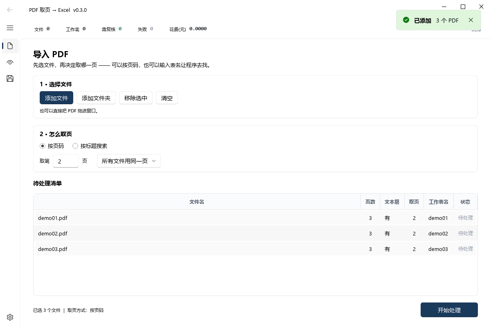
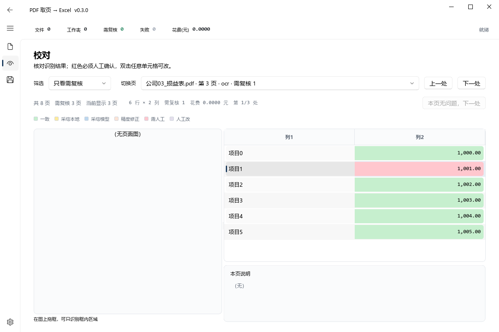
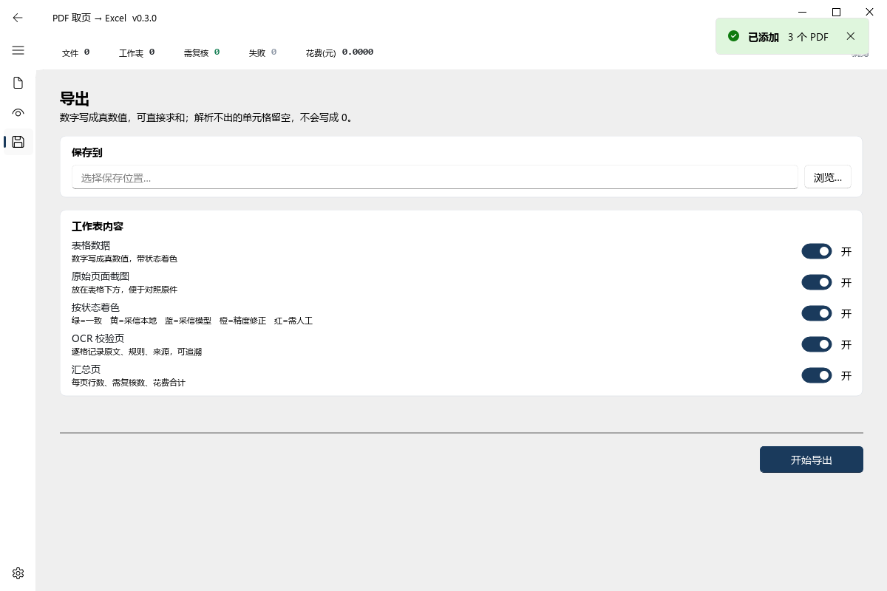
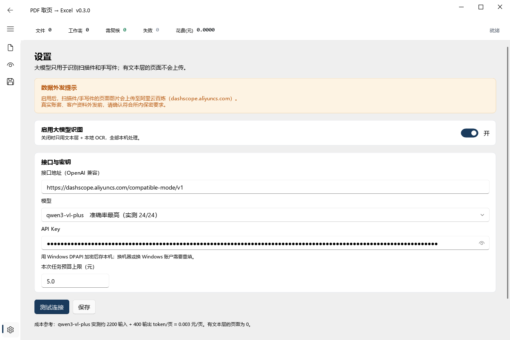

# 使用说明书 · PDF 取页 → Excel

版本 0.3.0 ｜ 适用：Windows 10/11 ｜ 全程本机处理，只有开启大模型时才会外发页面图片

---

## 一、这个工具干什么

从一批 PDF 里把指定的页面取出来，识别成表格，合成一份 Excel。三件事：

1. **取页** —— 按页码取，或按表名自动找（支持扫描件）
2. **识别** —— 印刷表格按表格线还原版式；扫描件/手写件用本地 OCR，必要时调用大模型
3. **导出** —— 一个子表一张工作表，还原合并单元格、列宽、字号、边框

典型场景：十家公司的损益表，每家一个 PDF，各取一页，合成十个工作表。

---

## 二、启动

双击 `run_gui.cmd`，或在该目录打开命令行执行 `python main.py`。

> 第一次启动会加载 OCR 模型（约 1 秒），之后不再重复加载。
> 界面是四个页面，左侧图标导航：**导入 / 校对 / 导出 / 设置**。

---

## 三、五步走完一次任务

### 第 1 步：加文件

「导入」页 → **添加文件**（可多选）或 **添加文件夹**（递归找 PDF）。
也可以直接把 PDF 拖进窗口。

清单会自动读出每个文件的**页数**和**有没有文本层**：

| 文本层 | 含义 | 影响 |
|---|---|---|
| 有 | PDF 里带文字（电脑生成的 PDF） | 不花钱、不上传、最准 |
| 无（扫描件） | 整页是图片 | 要走 OCR；开了大模型会上传图片 |

### 第 2 步：选取页方式

**方式 A · 按页码**（知道在第几页时用）

- `取第 __ 页`：所有文件取同一页（默认第 2 页，因为封面通常不算）
- 下拉框三种：
  - `所有文件用同一页` —— 十份文件的第 2 页
  - `在清单里逐个填` —— 双击清单「取页」列，每个文件填不同页码
  - `每个文件的全部页` —— 每页都取（注意：会跑满所有页）

**方式 B · 按标题搜索**（只知道表叫什么、不知道在第几页）

1. 表名框里填标题，例如 `管理费用明细表`
2. 目标可能是扫描件 → 打开 **扫描件也搜**（会跑本地 OCR，慢，一页 1~2 秒）
3. 点 **搜索**

搜到几页就取几页；一个文件命中多页时，每页各占一个工作表。

> **繁简自动兼容**：文件里印的是繁体「損益表」，你打简体「损益表」也能搜到，反过来同理。
> 搜不到时不要怀疑字形，看提示里写的三条原因。

### 第 3 步：开始处理

点右下角 **开始处理**。

- 处理中按钮会变成 **取消处理**，随时可停，已完成的保留
- 顶部状态条实时显示：`第 3/6 页 · 本地 OCR · 已用 00:12 · 预计还需 00:20`
- 清单「状态」列逐行推进：待处理 → 处理中 → 完成 / 需复核 / 失败

**处理中不要关窗口**。真要中断就点取消，等当前页跑完。

### 第 4 步：校对

处理完会自动跳到「校对」页（有失败页时会留在导入页，先让你看失败清单）。

**页数一多，逐页翻是不可能完成的**，所以校对页按「只看有问题的」组织：

顶部四个筛选：

| 筛选 | 显示什么 | 什么时候用 |
|---|---|---|
| 全部页 | 处理过的每一页 | 抽查，或复核某一份特定文件 |
| **只看需复核**（推荐） | 有红/蓝格、或整页失败的页 | 日常校对，几十页只跳十几处 |
| 只看冲突（红） | 只有红格的页 | 只想处理必须人工确认的 |
| 只看失败页 | 处理失败、没有结果的页 | 排查为什么没出来 |

配合三个按钮：

- **上一处 / 下一处** —— 在筛出来的问题页之间跳，跳过中间没问题的页
- **本页无问题，下一处** —— 本页确实没东西要改时点它，直接前进

三个细节是刻意设计的：

- **进页就停在第一个红格上**（红 > 蓝 > 橙），不用自己找
- **改完最后一个红格，「本页无问题」立刻变可点**；它还灰着时，鼠标悬停会告诉你「本页还有 N 格要人工确认」
- **汇总行**始终显示「共 N 页 / 需复核 M 页 / 当前显示 K 页」，一眼知道还剩多少要干

- 左侧是原始页面图，右侧是识别出的表格
- **颜色只表示可信度**，不是装饰：

| 颜色 | 含义 | 要不要动 |
|---|---|---|
| 白 | 一致 / 纯文本 | 不用 |
| 黄 | 采信本地 OCR | 建议扫一眼 |
| 蓝 | 采信大模型 | 建议扫一眼 |
| 橙 | 精度修正（小数位） | 建议扫一眼 |
| **红** | 双方冲突 | **必须人工确认** |
| 紫 | 你手工改过 | —— |

- **双击任意单元格**即可改值，改完变紫
- **在图上拖框** → 只识别框内区域并重跑这一页（页眉页脚的公司名、印章会被裁掉，也更省 token）

### 第 5 步：导出

选保存位置 → 按需开关这五项 → **开始导出**。

界面上只有这五个开关，默认全开：

| 开关 | 作用 | 什么时候关掉 |
|---|---|---|
| **表格数据** | 写识别出的表格 | 只想留原图做证据时 |
| **原始页面截图** | 把整页图贴在表格下方，便于对照原件 | 文件太大、或不需要留证时 |
| **按状态着色** | 绿=一致　黄=采信本地　蓝=采信模型　橙=精度修正　红=需人工 | 只想打印干净表格时（关掉就看不到哪些格要核） |
| **OCR 校验页** | 逐格记录原文、规则、来源 | 不需要追溯时 |
| **汇总页** | 每页行数、需复核数、花费合计 | 不需要时 |

> **黑框加粗**和**还原版式**（列宽/行高/字号/合并）**没有开关，一直生效**。
> 它们是导出时的固定行为，不需要你选。

---

## 四、设置大模型（可选）

**不开也能用**：有文本层的 PDF 完全不需要它；扫描件靠本地 OCR 也能出结果。
**开了更准**：扫描件、手写件、密集表单（像双语税表）质量差别很大。

步骤：

1. 接口地址默认 `https://dashscope.aliyuncs.com/compatible-mode/v1`，不用改
2. 模型选 `qwen3-vl-plus`（准确率最高）
3. 粘贴 API Key（阿里云百炼控制台 → API-KEY 管理，以 `sk-` 开头）
4. 点 **测试连接**，看到绿色「连接正常」才算通
5. 打开开关 → 会弹一次**隐私确认**，点「我已确认，启用」
6. 看到「已启用并保存」就落盘了，下次启动仍生效

> **开关打开 ≠ 真的在用**。界面上会明确告诉你为什么没用上：
> Key 是占位符、Key 填成了网址、没确认隐私、开关是关的 —— 都会写在导入页左下角。
> 这几个坑都实测踩过，现在不会再静默失败。

**费用**：qwen3-vl-plus 约 2200 输入 + 400 输出 token/页 ≈ **0.003 元/页**。
有文本层的页不上传、不花钱。顶部「花费(元)」实时累计，可在设置里设单次预算上限。

---

## 五、识别是怎么做的（决定你该不该开大模型）

工具按这个顺序尝试，能用便宜的就不到贵的：

| 顺序 | 方法 | 适用 | 花钱 |
|---|---|---|---|
| 1 | 文本层抽表 | 有文字、有框线/空白清晰 | 0 |
| 2 | 文本层按坐标聚类 | 有文字、无框线 | 0 |
| 3 | **按表格线还原** | 扫描件但印刷线清楚 | 0 |
| 4 | 本地 OCR 聚类 | 扫描件、线不清楚 | 0 |
| 5 | 大模型 | 手写、密集表单、线不清楚 | 0.003 元/页 |

**第 3 步是扫描件的首选**：印刷表格线是现成的坐标信息，比任何文字聚类都准。
它会还原合并单元格、列宽、行高、字号、边框，一个子表出一张工作表。
走这条路时**不会调用大模型**，也不上传图片 —— 备注里会写「版式已由表格线确定」。

---

## 六、常见问题

### Q1 导出的数字显示成 `###`

不是科学计数法，是**列宽装不下**。0.3.0 已按内容自动加宽数字列，正常情况下不再出现。
若仍有，把那一列的位置告诉我（如「损益表 C 列」）。

### Q2 同一张表里字大大小小

已修。字号原来逐格从 OCR 框高度估算，框高有抖动。现在整页统一三档：
表名 / 表头 / 正文（脚注单独小一号）。**框的位置不受影响**，仍按原表的线。

### Q3 明明有「損益表」却搜不到

两种可能：

1. **繁简差异** —— 已自动兼容，不用管
2. **OCR 没认出那行** —— 常见于被印章、手写、污渍压住的标题

搜不到时界面会留下一条结果条，写明「扫了几个文件几页、共识别多少字符」：

- 字符数正常（几千）→ OCR 工作了，是词对不上，试着**只填关键字**（「损益」而不是「损益表」）
- 字符数是 0 → 那几页根本没读出字（纯图片/加密），搜索用不上，**直接按页码取**

### Q4 某一行的标签是空的，但金额是对的

那一行的文字被印章/涂改压住，OCR 整句没认出来 —— 不是行切错位。
处理办法二选一：

- 在校对页双击那个空格手补
- 该页单独开大模型重跑（视觉模型能读懂被压住的字）

### Q5 一页导出了三张工作表，能不能合成一张

不能，这是 Excel 的限制：**列宽是工作表级的**。
一页里三个子表列数不同（比如 5/7/5），塞进同一张表必然把其中两个的列宽拉歪。

### Q6 处理完发现少了几页

看「状态」列和顶部「失败」计数。失败页会留在清单上变红，并自动滚进可见区。
导入页上方会有一条结果条，逐条列出失败页和原因，旁边有 **重试失败项**。
重试只跑失败的那几页，已成功的不会重算。

### Q7 想中途停下来

处理中 → 点右下角 **取消处理**。停止派发后续页，已完成的保留，未开始的标「已取消」。
搜索中 → 点 **取消搜索**。取消后不会自动开工，已扫到的命中不加入清单。

### Q8 API Key 存哪、安全吗

用 Windows DPAPI 加密后存到 `%APPDATA%\pdf2xlsx\config.json`，只有本机当前账户能解。
换机器或换 Windows 账户需要重填。

### Q9 开着大模型但一分钱没花

看导入页左下角的提示。三种常见原因：Key 是占位符（太短）、Key 填成了网址、没确认隐私。

### Q10 扫描件很慢

本地 OCR 一页 1~2 秒，18 页要 30 秒左右。搜索阶段要扫完全部页才能判断有没有命中。
进度条按**页**推进，能看到第几页。

---

## 七、数据合规（务必先看）

- **默认全程本机**：不开大模型时，PDF 内容不离开这台电脑
- **开了大模型**：只上传**需要 OCR 的页面图片**（有文本层的页不上传），发往阿里云百炼
- **真实账套、客户资料外发前**，请先确认符合所内保密要求
- 建议：先用校对页**框选表格区域**再重跑，这样只上传表格那块，页眉里的公司名、税号不会被传出去

---

## 八、已知限制

| 限制 | 说明 |
|---|---|
| 手写数字 | 本地 OCR 不可靠，需开大模型；仍可能错，红格必须人工核 |
| 印章/涂改压字 | OCR 会漏整行文字，需人工补 |
| 表格线极浅 | 线检测可能漏线导致行切偏，可改用大模型 |
| 跨页表格 | 暂不自动拼接，需分页取 |
| 加密 PDF | 不支持，请先解密 |
| 多子表一页 | 一个子表一张工作表，不能合并 |
| 字体族 | 只还原字号/粗细/对齐，不保证与原件的字体族一致 |

---

## 九、给维护者

- 技术细节与踩坑记录见 `README.md`
- 跑测试：`python -m pytest tests -q`（当前 257 passed, 2 skipped）
- 版式还原效果自查：`python tools/render_layout_preview.py <pdf> <页码> out.png`
  会把还原结果按原页面坐标系画出来，与原件左右并排，一眼看出哪里不对
